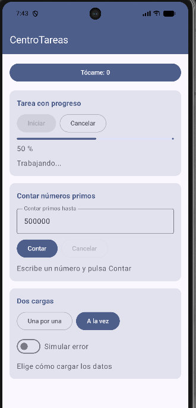
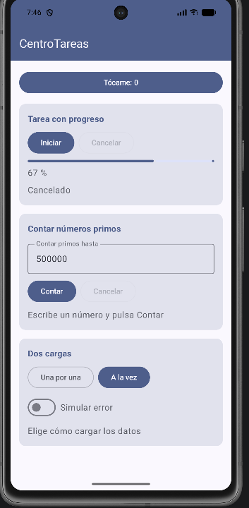
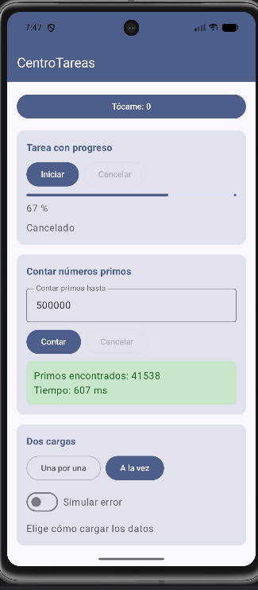
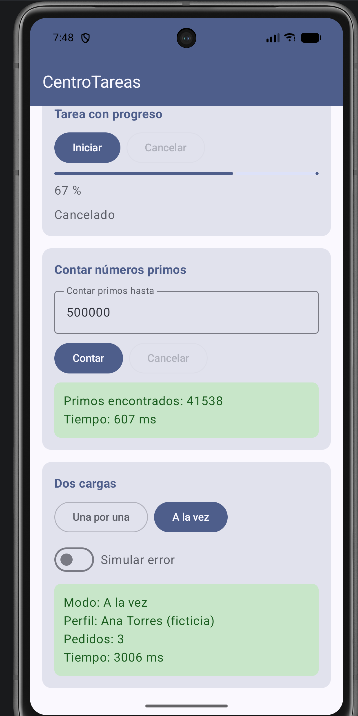
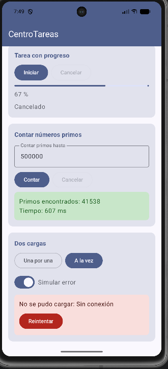

# CentroTareas

Aplicación Android que hace tres tareas que tardan sin congelar nunca la pantalla: una tarea con barra de progreso que se puede cancelar, un cálculo pesado (contar números primos) y dos cargas de datos simuladas, comparando cargarlas una por una contra cargarlas a la vez. Primero se provoca el congelamiento con `Thread.sleep` y luego se resuelve con corrutinas.

- **Curso:** Programación en Móviles — Tecsup
- **Laboratorio:** GLAB-S14 · Hilos en Android
- **Docente:** Juan León S.
- **Alumno:** Yony Ortiz
- **Tecnología:** Kotlin + Jetpack Compose + Material 3 (sin XML), corrutinas y ViewModel
- **Patrón:** MVVM + Repository (interface)

## Funcionalidades

- Botón **Tócame** que cuenta los toques: es la prueba de vida de la pantalla.
- **Tarea con progreso:** barra de 0 a 100 % en ≈ 4 s con `viewModelScope.launch` y `withContext(Dispatchers.Default)`; se puede **cancelar** con un `Job` y no se lanzan dos a la vez.
- **Contar números primos:** cálculo pesado en `Dispatchers.Default` dentro del Repository, cancelable con `ensureActive()`; muestra la cantidad y el tiempo.
- **Dos cargas:** perfil (2 s) y pedidos (3 s) **una por una** (≈ 5 s) o **a la vez** con `async` (≈ 3 s).
- **Errores:** interruptor **Simular error**, recuadro rojo con el mensaje y botón **Reintentar**; la app nunca se cierra.

## Estructura de paquetes

```
com.ortiz.centrotareas/
├── MainActivity.kt
├── model/
│   └── Estados.kt                  PrimosUi, CargaUi
├── data/
│   ├── TareasRepository.kt         interface
│   └── TareasRepositoryLocal.kt    cargas simuladas y contarPrimos
├── viewmodel/
│   ├── TareasViewModel.kt
│   └── TareasViewModelFactory.kt
└── ui/
    ├── PantallaTareas.kt           las tres tarjetas
    └── theme/
```

## Arquitectura MVVM + Repository

```
View (PantallaTareas)
    |  eventos: botones            ^  collectAsState()
    v                              |
ViewModel (TareasViewModel) --- StateFlow --->
    |  viewModelScope.launch { ... }
    v
TareasRepository (interface) ---> TareasRepositoryLocal
                                  (cargas simuladas y contar primos)
```

| Capa | Conoce a | NO debe |
|---|---|---|
| View (ui/) | Solo a su ViewModel | Lanzar corrutinas ni usar Thread; solo muestra el estado y avisa los eventos |
| ViewModel | Solo a la interface del Repository | Conocer Composables, recibir un Context ni bloquear el hilo principal |
| Repository | Nada de la UI | Exponer estados de pantalla. Sus funciones suspend no bloquean el hilo desde el que se llaman |

## Observaciones

### Observación del Paso 1

**¿Qué pasa con la pantalla?**
Al tocar **Tarea larga (MAL)** la app se queda congelada unos 4 segundos: el botón **Tócame** no suma, nada responde a los toques y luego, de golpe, aparece **Terminó**.

**¿Por qué no se ve "Trabajando..."?**
Porque `Thread.sleep(4000)` se ejecuta en el **hilo principal**, que es el mismo que dibuja la pantalla. El mensaje cambia a "Trabajando...", pero el hilo queda dormido y no puede volver a dibujar; cuando despierta, el mensaje ya cambió a "Terminó", así que solo se ve el resultado final.

**¿Qué mostraría Android si la espera fuera de 10 segundos?**
Android mostraría el cuadro **ANR (Application Not Responding)**, "La app no responde", con las opciones de cerrar la app o esperar, porque el hilo principal estuvo bloqueado más de 5 segundos sin atender los toques del usuario.

## Capturas

| Tarea con progreso | Tarea cancelada | Primos |
|---|---|---|
|  |  |  |

| Una por una contra a la vez | Error |
|---|---|
|  |  |

## Para pensar

**1. ¿Por qué no se veía Trabajando... en el Paso 1?**
Porque `Thread.sleep(4000)` bloqueaba el hilo principal, que es el único que dibuja la pantalla. El mensaje sí cambiaba a "Trabajando...", pero el hilo no podía redibujar mientras dormía; cuando despertó, el mensaje ya era "Terminó" y solo se vio ese.

**2. ¿Qué diferencia hay entre Thread.sleep y delay?**
`Thread.sleep` bloquea el hilo completo: nadie más puede usarlo mientras espera. `delay` es una función `suspend` que solo **suspende la corrutina** y libera el hilo para otras tareas; además revisa la cancelación, así que una corrutina en `delay` se puede cancelar.

**3. ¿Por qué Dispatchers.Default para los primos y Dispatchers.IO para la red?**
Contar primos usa mucho **procesador**; `Default` tiene tantos hilos como núcleos del CPU, ideal para cálculos. La red o el disco pasan la mayor parte del tiempo **esperando** una respuesta; `IO` tiene un grupo de hilos más grande pensado para muchas esperas a la vez.

**4. ¿Qué pasaría con la corrutina si el usuario cierra la pantalla? ¿Qué papel cumple viewModelScope?**
`viewModelScope` está atado al ciclo de vida del ViewModel: si el usuario sale de la pantalla y el ViewModel se destruye, todas sus corrutinas se **cancelan solas**, así no queda trabajo huérfano ni fugas de memoria. Al rotar la pantalla el ViewModel sobrevive, por eso la tarea continúa y el progreso no se reinicia.

**5. ¿Por qué async tarda 3 s y no 5 s? ¿Qué pasa si una de las dos cargas falla?**
Con `async` las dos cargas empiezan al mismo tiempo, así que el total es el de la más lenta: máximo(2 s, 3 s) ≈ 3 s. Una por una se suman: 2 s + 3 s ≈ 5 s. Si una falla dentro de `coroutineScope`, se cancela la otra y la excepción sube al `try/catch` del ViewModel, que muestra el recuadro de error con **Reintentar**.
